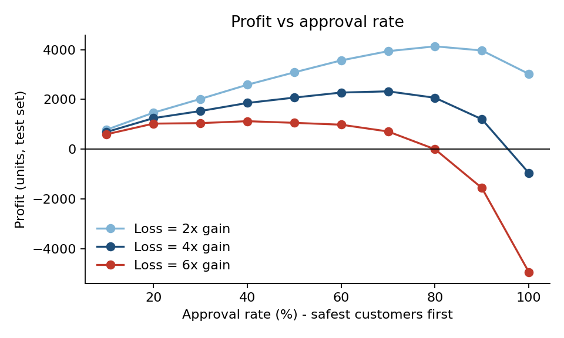
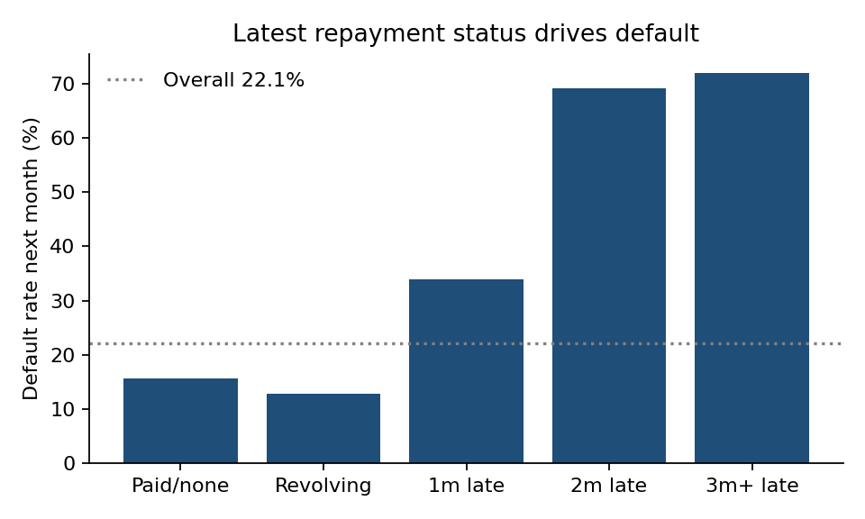
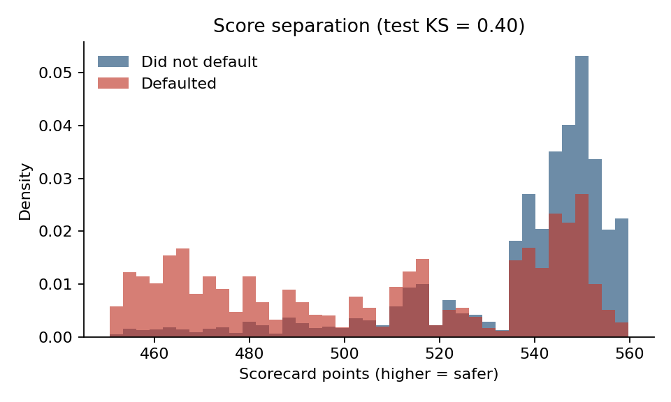

# Credit Default Scorecard: Who Should We Approve?

> One-page version for non-technical readers: [EXECUTIVE_SUMMARY.pdf](EXECUTIVE_SUMMARY.pdf)

**Business question:** 22% of credit card customers in this dataset default the following month. Can a transparent, bank-style scorecard rank customers by risk, and where should the approval cut-off sit so that lending is profitable?

**Answer in one line:** A six-variable scorecard (test AUC 0.753, Gini 0.51, KS 0.40) lets us approve the safest 70% of customers, cutting the default rate among approved customers from 22.1% to 12.7% and turning a **-955 loss into a +2,326 profit** on held-out data, under an assumed loss-to-gain ratio of 4 to 1.

| Strategy (held-out test set, 9,000 customers) | Approved | Default rate among approved | Profit* |
|---|---|---|---|
| Approve everyone | 9,000 | 22.1% | **-955** |
| **Approve safest 70% (cut-off chosen on training data)** | **6,361** | **12.7%** | **+2,326** |

\*Profit in units: an approved good account earns 1, an approved defaulter loses 4 (an **assumption**, see below). Break-even default rate = 1 / (1 + 4) = 20%, which is below the 22.1% portfolio rate, so approving everyone loses money.



## Tools used

| Tool | Where | What for |
|---|---|---|
| **Python** (pandas, scikit-learn, scipy, matplotlib) | `src/` | Cleaning, feature engineering, WoE/IV binning, scorecard, evaluation, charts |
| **SQL** (SQLite) | `sql/` | Segment default rates, risk-decile table (`NTILE`), cumulative profit by approval depth |
| **Statistics** | `src/02_statistics.py`, `src/03_scorecard.py` | Chi-square, Mann-Whitney, Bonferroni, bootstrap CI, KS statistic, calibration, information value |

## Project structure

```
data/raw/UCI_Credit_Card.csv        original file (30,000 rows)
data/processed/credit_clean.csv     cleaned + engineered features
sql/01_segment_default_rate.sql     default rate by segment
sql/02_score_bands.sql              risk deciles on the test set
sql/03_cutoff_by_depth.sql          profit by approval depth for several loss ratios
src/01_clean_load.py                clean data, build features, load SQLite
src/02_statistics.py                hypothesis tests and bootstrap CI
src/03_scorecard.py                 WoE/IV, logistic scorecard, evaluation, cut-off, fairness audit, charts
src/04_run_sql.py                   run the SQL files and save result tables
outputs/                            tables and charts
EXECUTIVE_SUMMARY.pdf               one-page summary
```

## How to run

```bash
pip install -r requirements.txt
./run_all.sh        # or run the four scripts in src/ in order
```
Requires Python 3.9+ and SQLite 3.25+ (window functions).

## 1. Data and cleaning

30,000 customers, 24 raw columns, no missing values, 22.12% defaulted (6,636). The target is `default.payment.next.month`. No rows were dropped. Decisions:

- `EDUCATION` codes 0, 5, 6 are undocumented (345 rows) and were merged into "other"; `MARRIAGE` code 0 (54 rows) likewise.
- 590 customers have a negative latest bill (credit balance). They were **kept**, and utilisation is floored at zero.
- `PAY_0` was renamed `PAY_1` for consistency. Repayment status: -2 no use, -1 paid in full, 0 revolving, 1+ months late.

Features, all built from the six months **before** the default month: latest and 6-month average utilisation, share of latest bill paid, 6-month payment ratio, number of months late, worst delay.

## 2. What drives default (SQL + statistics)



- **Late payment is the dominant signal.** Customers with any late payment in the last six months defaulted at **42.7%** vs **11.7%** for those never late (gap 31.0 points, 95% bootstrap CI 29.9 to 32.1). Two months late: 69%.
- **Credit limit:** default rate falls from 36.1% (limit under 50k) to 15.1% (200k+). Caveat: the limit may itself reflect the bank's earlier risk view.
- **Quirk worth knowing:** customers who "paid in full" (15.6%) default slightly more than revolving customers (12.8%). The scorecard handles this with weight of evidence instead of forcing a monotonic trend.
- **Statistical tests (12, Bonferroni-corrected):** everything is significant except age (p = 0.37). Effect sizes tell the real story: months-late indicator Cram\u00e9r's V = 0.35, education 0.07, sex 0.04, marital status 0.03. Probability a defaulter has a longer worst delay than a non-defaulter: 0.72.

Full table: `outputs/statistical_tests.csv`.

## 3. The scorecard (Python)

Standard bank method: bin each variable, compute **weight of evidence** (WoE = ln of share of goods over share of bads in the bin) and **information value** (IV = predictive strength), fit a logistic regression on the WoE values, and convert to points (600 points = 50:1 good:bad odds; +20 points doubles the odds).

1. 70/30 stratified train/test split (seed 42). Bin edges and WoE are learned on **train only**.
2. **IV screening:** variables with IV below 0.02 are dropped (age, IV 0.011).
3. **Sign pruning:** higher WoE means safer, so every coefficient must be negative. Variables with a positive sign (a collinearity symptom) are dropped, weakest first: latest utilisation, latest payment ratio, `PAY_2`.
4. **Final variables (6):** `PAY_1`, months late, worst delay, credit limit, 6-month utilisation, 6-month payment ratio.
5. **Not used as inputs:** sex, marital status, education (see fairness below).

| Metric (held-out test) | Value |
|---|---|
| AUC | 0.753 (train 0.767) |
| Gini (2 x AUC - 1) | 0.506 |
| KS statistic | 0.397 |
| Benchmark: gradient boosting, raw features | AUC 0.779 |
| Benchmark: latest repayment status alone | AUC 0.683 |



**Calibration (test, by risk decile):** the riskiest decile is spot on (predicted 68.7%, actual 68.7%). The safest decile is over-predicted (8.2% vs 5.0%), and deciles 6-8 are under-predicted (for example 10.2% vs 14.4%). Good enough for ranking, not for precise provisioning.

Points per bin: `outputs/scorecard_points.csv`. IV table: `outputs/information_value.csv`.

## 4. Cut-off economics (SQL + Python)

Break-even default rate = 1 / (1 + R), where R is how many good accounts one default wipes out. The cut-off is chosen on **training** data, then evaluated on test:

| Loss-to-gain ratio R | Break-even default rate | Approval rate chosen | Test profit at cut-off | Test profit, approve all |
|---|---|---|---|---|
| 2 | 33.3% | 80% | +4,135 | +3,027 |
| 3 | 25.0% | 70% | +3,133 | +1,036 |
| **4** | **20.0%** | **70%** | **+2,326** | **-955** |
| 6 | 14.3% | 50% | +1,060 | -4,937 |

The higher the cost of a default, the tighter the cut-off. `sql/03_cutoff_by_depth.sql` reproduces the profit curve by test decile.

## 5. Fairness audit

Sex, marital status and education are excluded from the model, and age was dropped by the IV screen. As a check, approval rates at the R = 4 cut-off on the test set: men 69.7%, women 71.2%; under 30: 67.1%, 30-39: 73.0%, 40-49: 72.4%, 50+: 69.0%. Among approved customers men default at 14.1% vs 11.7% for women, so the model is not equally calibrated across sexes. Excluding a variable does not remove its influence through correlated variables; a real deployment needs a proper fair-lending review.

## Assumptions and limitations

1. **The loss-to-gain ratio is an assumption.** There are no real revenue or loss figures. Conclusions scale with R; the table above shows the sensitivity.
2. **Random split, not out-of-time.** Real scorecards are validated on later periods. This data covers about six months of history from one bank in Taiwan in 2005, so stability over time is untested.
3. **The credit limit may be circular.** It was set by the bank, possibly using its own risk view, so part of its predictive power may be earlier risk screening.
4. **The scorecard gives up 0.026 AUC to gradient boosting.** That is the price of an explainable points table; in regulated lending that trade is normal.
5. **Old, public, small-history data.** Treat the results as a worked method, not as business conclusions.

## Possible next steps

- Out-of-time validation and a population stability index (PSI) check
- Replace the assumed ratio with real revenue and loss-given-default figures
- Reject-inference thinking: customers who were declined never show whether they would have defaulted
- A formal fairness review before any use
